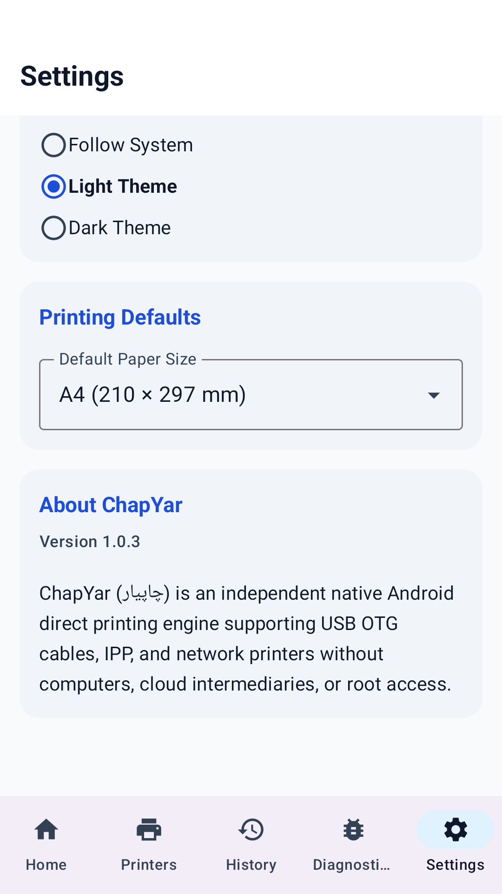
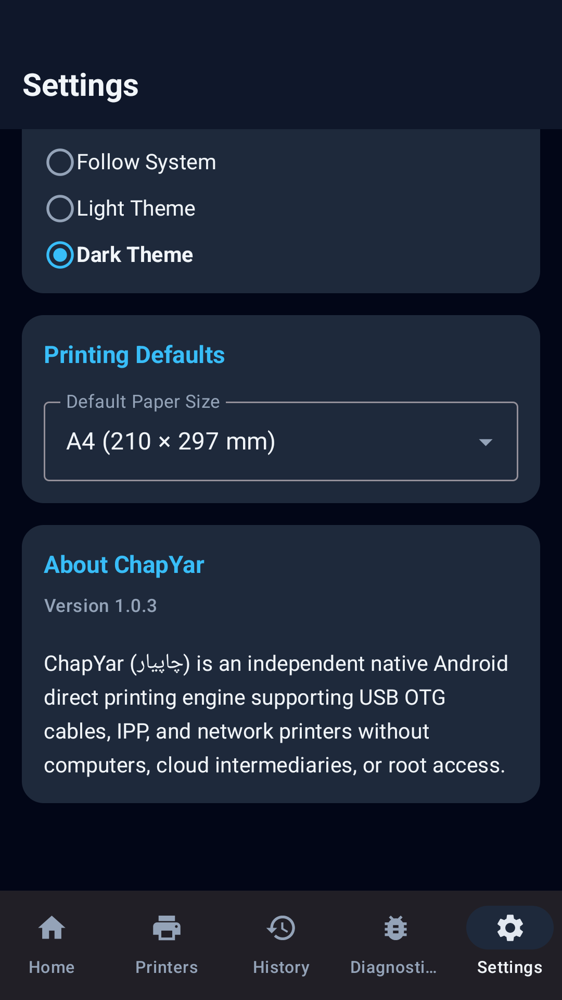
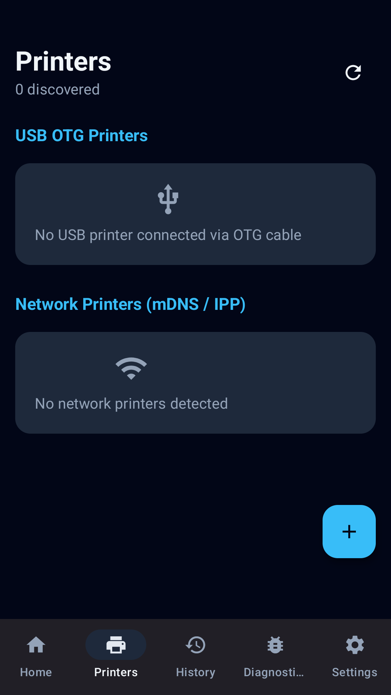
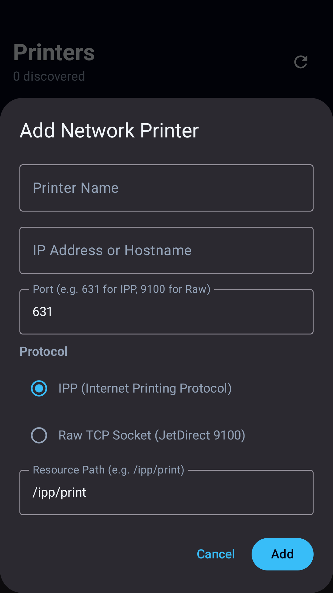
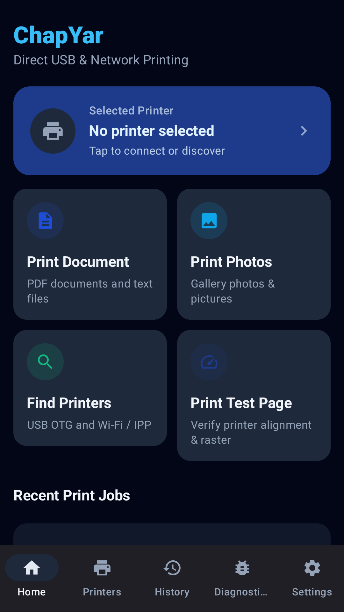
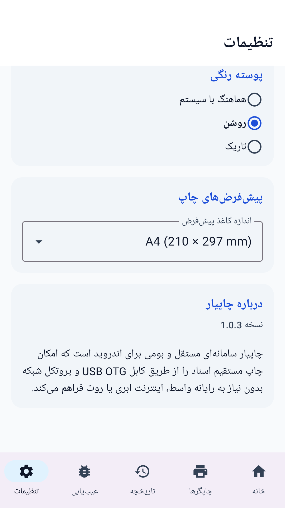
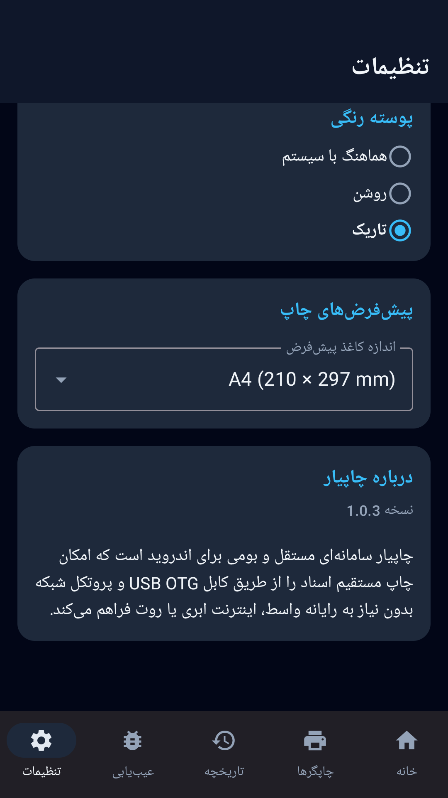
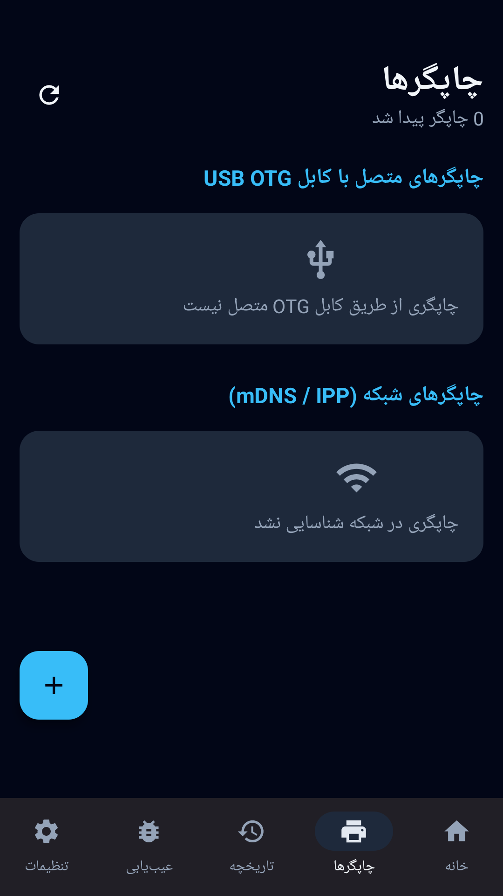
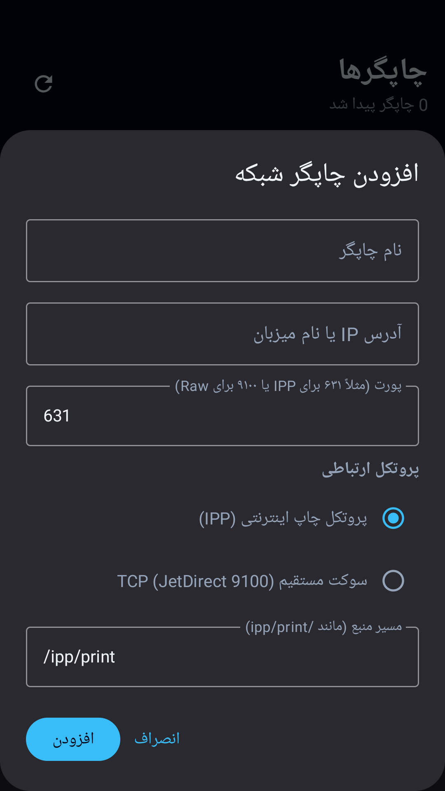
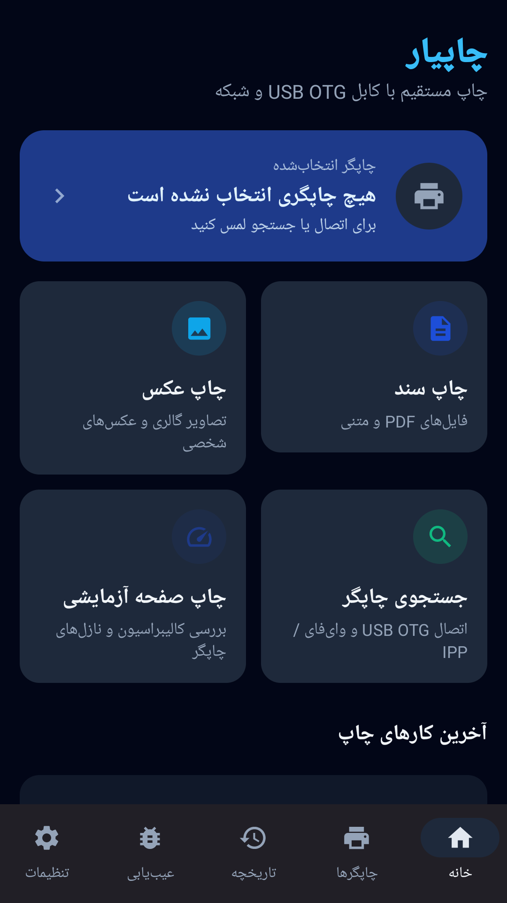

# ChapYar — چاپیار

[Download / دریافت نسخه 1.0.3](https://github.com/cinaasadpour-hash/chapyar/releases/tag/v1.0.3)

چاپیار برای چاپ مستقیم اسناد و عکس‌ها با چاپگرهای سازگار USB OTG و شبکه طراحی شده است.

امکانات:
• انتخاب فایل PDF، متن و تصویر و بررسی پیش‌نمایش پیش از چاپ
• جستجوی چاپگرهای USB و شبکه و افزودن دستی چاپگر با نشانی شبکه
• تنظیم اندازه کاغذ، جهت صفحه، تعداد نسخه، کیفیت و محدوده صفحات
• مشاهده وضعیت کارهای چاپ و تاریخچه
• ابزارهای عیب‌یابی اتصال و چاپ صفحه آزمایشی
• زبان فارسی و انگلیسی و پوسته روشن، تیره یا مطابق گوشی

برای چاپ USB به گوشی دارای USB Host/OTG، کابل مناسب و چاپگر سازگار نیاز دارید. برای چاپ شبکه، گوشی و چاپگر باید به شبکه مناسب دسترسی داشته باشند. پشتیبانی به مدل و زبان چاپگر بستگی دارد؛ سازگاری با تمام چاپگرها تضمین نمی‌شود. برای اسناد Office ابتدا خروجی PDF تهیه کنید.

برنامه دارای تبلیغات است. اسناد برای چاپ به چاپگر انتخابی ارسال می‌شوند. پیش از چاپ، چاپگر مقصد و تنظیمات را بررسی کنید.

ChapYar helps you print documents and photos directly with compatible USB OTG and network printers.

Features:
• Select PDF, text and image files and review a preview before printing
• Discover USB and network printers, or add a printer by its network address
• Adjust paper size, orientation, copies, quality and page ranges
• View print-job status and history
• Connection diagnostics and a test-page option
• Persian and English, with light, dark and system themes

USB printing requires a USB Host/OTG-capable phone, a suitable cable and a compatible printer. Network printing requires access to the appropriate printer network. Support depends on printer model and printer language; not every printer is supported. Export Office documents to PDF first.

Contains advertising. Selected documents are sent to the printer you choose. Check the destination and settings before printing.

Package: `com.sinatools.chapyar` · Android 7.0+ · Version 1.0.3 (4)

[Privacy / حریم خصوصی](PRIVACY.md)

<!-- STORE-GALLERY -->

## Screenshots | تصاویر برنامه

App screens in English and Persian; sample content is used where needed.

### English

### فارسی

